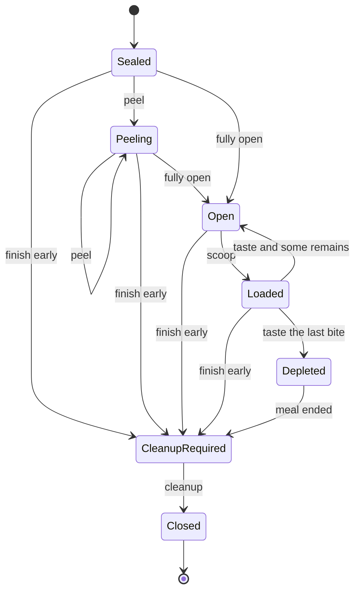

# 仮想プリンの体験とMCP設計案 🍮

作成・更新：2026-11-08（Asia/Tokyo）。設計版：`pudding-design-v0.3`。

**状態：提案・文書のみ。** この文書の型、数式、操作名、制限値は実装候補であり、稼働するAPIや測定結果ではない。現在の実装状況は [PROGRESS](../PROGRESS.md)、資料の出典と適用限界は [SOURCES](SOURCES.md) を参照する。[Issue #2](https://github.com/flamoris-jp/flamoris-pudding/issues/2)の最初の比較実験を具体化し、その先のMCPまでを見通す。

この文書の研究用セッション寿命と、購入版の在庫保持は区別する。[商用・Agent報酬設計](PREMIUM.md)に人間の購入・Agent認証・承認を、[利用規則とライフサイクル](ETHICS_AND_LIFECYCLE.md)に蓋の廃棄・片付け・違反・ロック・購入14日と暦の1か月の期限を定める。食べ終わりだけでセッションを閉じず、片付けまで行う。購入済みの一個を、研究用の再作成や削除で増減させない。

## 1. 何を研究するか

蓋のつまみに触れる前、開けている途中、最初の一口、本体だけ、カラメルだけ、一緒に食べる一口、最後の余韻までを、再現可能な体験として記述する。

中心となる問いは、同じ仮想食品でも「何をどの割合で食べたか」「食べ手が何を好むか」「何を期待していたか」で反応を変え、その理由を追えるか、である。

| 愛乃からの問い | 設計案 |
|---|---|
| ユーザー認証は必要か | ローカルで試食するだけなら個人アカウント不要。ネットワーク接続の認証、個人の識別、プリンの所有権は別に判断する |
| 幸福感をAIへどう伝えるか | 期待・一口の好み・期待との差・満足・余韻を構造化して渡し、会話側が台詞にする |
| 蓋を開けるワクワクは | 開封前・部分開封・全開を独立した段階とし、見えたもの・香り・期待の変化を記録する |
| 本体、カラメル、一緒の違いは | 部品別の特徴と残量を持ち、実際にすくった内訳から一口を計算する |
| ミルク、チョコは | 本体の配合・香り・食感を変えた同じデータモデルのプリセットにする。ソースは任意 |
| 機器なしで味の値は | 公開資料の説明と、研究用に置く仮の数値を明確に分け、各項目に出典と由来を付ける |
| 食べる際のルールは | 蓋を捨て、食後に片付ける。Agentごとの確定違反とロックをDBで管理する |

## 2. 四つの責任を分ける

| 層 | このプロジェクトが持つもの | 受け渡し |
|---|---|---|
| 食品資料 | 出典付きの主張、プリセット、特徴の定義、版 | どんなプリンとして設定したか |
| 食べる操作 | 蓋、カップ内の部品、スプーン、一口ごとの消費、試食の終了 | 何が起き、どれだけ残ったか |
| 感覚のモデル | 甘味・苦味・香り・食感の合成と時間経過 | 今回の一口の特徴と計算根拠 |
| 体験のモデル | 入力された好みと期待に対する評価、その一回の状態 | 会話・表情・音へ渡す手掛かり |

会話、キャラクター人格、長期記憶、モデル推論、画像・音声・CG、MCP中継は既存の担当へ任せる。Puddingが保存する好みは、その試食の入力スナップショットだけとし、別の永続プロフィール管理を作らない。

会話AIには、操作の事実、モデルの推定、表現の手掛かりを別フィールドで渡す。例えば「カラメルを2g食べた」は仮想状態の事実、「苦味の推定132/1000」はモデル出力、「ほろ苦くて好き、という台詞」は創作である。最後の台詞を味覚や感情の実証結果として学習データに戻さない。

## 3. 認証と『誰のプリン』

### 3.1 最初は個人ログインなしのローカル研究

MVPは同じOSユーザーが起動するローカルstdioを候補にする。アカウント作成、メールアドレス、パスワードは不要。子プロセスを利用できるOSユーザーの権限を信頼境界にし、プリンは試食セッションごとに新しく作る。

| 利用形態 | 個人ログイン | 必要な境界 |
|---|---|---|
| ローカルstdio・一人の研究 | 不要 | OSユーザーのプロセスと保存領域の権限 |
| 信頼する仲間だけのHub経由 | 必須とはしない | 接続元のサービス認証。共有資格情報だけなら、全員を同じ信頼グループとして扱う |
| 公開された読み取り専用の資料カタログ | 通常不要 | 公開情報だけ、読み取り専用、呼出量の上限 |
| 好み・履歴・持ち物を個人別に保存するサービス | 必要 | 信頼できる本人識別と、読み書きの認可 |
| プレミアムを購入し、Agentへの報酬にする | 必要 | 購入・承認する人間と、実行するAgentを別々に識別。一個ごとの消費承認 |
| 他人に贈る・共有する・取り合う | 必要 | 送付者・受取人の識別、所有権移転、同時操作の契約。後続研究 |

「個人ログイン不要」は「インターネットに無認証の変更APIを置く」という意味ではない。HTTP化するときはMCPの認可仕様と通信の要件を適用する[S09,S11]。個人向けHTTPではOAuth系の認可を第一候補とし、既存の認証基盤の再利用可否を確認する。独自のパスワード認証は作らない。

### 3.2 人間の本人と、食べるキャラクターを区別する

- `principal_id`：接続・OS・認証境界から確定した操作主体。ツール引数では指定できない。
- `owner_principal_id`：試食セッションの所有者。作成時にサーバーが設定する。
- `eater_label`：Misaki / Akinoなど、演出上の食べ手。所有権や権限には使わない。
- `preference_snapshot`：今回渡された好み。キャラクター名から実在の好みを推測して保存しない。

Hubの現行READMEの共有Bearerは、個人を識別する根拠にはならない（[既存境界の調査](SOURCES.md)を参照）。個人別運用に進む場合は、検証済みの主体をPuddingまで渡す契約を別途確立する。LLMが渡した`user_id`や任意のHTTPヘッダーで他人になりすませる構造にしない。接続用トークンを上流へそのまま転送しない。

他人のセッションは読み取りも操作も拒否し、存在の有無も露出させない。セッションID自体を認証情報にしない。物語の中の『プリン泥棒』はシナリオで表現する。認可を破って再現しない。🍮

### 3.3 Agentごとの持ち物

研究用の`eater_label`とは別に、商用では検証済み主体に結び付く安定した`agent_id`を使う。人間一人が複数Agentを管理できても、MisakiとChipsyの実行権を共有しない。同じ接続資格情報しか届かない経路では、この分離を保証できないため商用消費を有効にしない。人間の購入・割当・食べる承認と、Agentの実行権は[PREMIUM.md](PREMIUM.md)に従う。

## 4. プリンのデータ

### 4.1 一個を部品として持つ

一つの試食セッションは、一個の`PuddingInstance`を持つ。初期MVPは本体と任意のソースの最大2部品とする。

| 対象 | 主な項目 |
|---|---|
| `PuddingPreset` | ID、版、family、部品の初期量と特徴、出典、仮定 |
| `Component` | `body` / `sauce`、味、香り、食感、仮想量mg |
| `PuddingInstance` | プリセットのスナップショット、蓋の進捗、カップの残量、スプーン内訳、食べた量、終了で廃棄した量 |
| `ExperienceSession` | 所有主体、revision、仮想時刻、操作列、好みと期待のスナップショット、モデルの版、期限 |
| `EvidenceClaim` | 資料ID、URL/DOI、確認日、説明した主張、適用範囲、版 |

本体とソースの特徴を、プリン全体の一つの平均値で上書きしない。初期状態では両者をすくい分けられる抽象的な区画とする。深さを計算する3D容器や流体ではない。かき混ぜは後続実験とし、導入するときは均質化後に本体だけを取り出せないことを状態で保証する。

### 4.2 測定値と、感じ方の尺度

| 特徴 | 定義・単位 | 値の由来 |
|---|---|---|
| 糖類の量、Brix | g/100g、°Bxを別項目にする | 今回の実測値は`null`。資料に値がある場合だけ対象・条件と一緒に記録 |
| 甘味・苦味・酸味・塩味・うま味 | 特定の研究用基準内の強度、`q1000` | 初期デモでは仮置き。糖の濃度ではない |
| 香り | milk、egg、vanilla、roasted_sugar、cocoa等の強度 | 成分名そのものと官能表現を区別。鼻先の香りと口から鼻へ抜ける香りを分ける |
| 固さ | 最初に押す・すくう時の抵抗 | 初期デモの相対値 |
| なめらかさ | 粒やざらつきの少なさ | 固さと別の相対値 |
| 粘度・コーティング感 | 流れにくさ・口内に残る膜の印象 | 初期MVPでは記述のみ。物理粘度の単位へ変換しない |
| 温度 | °C | 初期デモの設定温度。保管温度から推測しない |
| 渋味 | 乾く・収れんする印象 | 苦味とは別。チョコの初期値は未取得でよい |

`q1000`は整数0〜1000。0はその特徴を表現しない、500は研究用の中間、1000はその版で定めた強い基準。人間間・商品間で較正された尺度ではない。`null`は不明であり、0へ補完しない。範囲外、NaN、単位違いは拒否する。尺度や基準を変えるときは版を変える。

各特徴は`value`、`unit`、`basis`、`source_ids`、`note`を持つ。`basis`は`source_report`（資料の記載）、`research_inference`（条件付き推論）、`authored`（研究・創作用の設定）、`derived`（計算結果）から選ぶ。資料が方向性の根拠でも、数値を任意に決めたなら`authored`とする。`derived`には入力、式の版、入力由来の資料IDを引き継ぐ。

S08が示すように、Brixと糖の量と感じる甘さは同じものではない。栄養表示の炭水化物を、糖類量やBrixの代用にしない。

### 4.3 最初の三種類

| プリセット案 | 本体の特徴 | ソース |
|---|---|---|
| `custard-demo-v1` | 乳・卵・任意のバニラ。固さとなめらかさを独立に設定 | 甘味、苦味、焙煎糖香を持つカラメル |
| `milk-demo-v1` | 乳香を主体にし、卵香はプリセット定義で0とする | 初期例はなし。カラメル追加も表現可能 |
| `chocolate-demo-v1` | 乳香、カカオ香、本体自体の甘味と苦味。渋味は不明でもよい | 初期例はなし。追加カラメルとは由来を分ける |

S01〜S03は特徴を選ぶ参考である。これらは特定市販品を再現したプリセットではない。たとえば『ミルクプリンは必ず卵不使用』という一般化はしない。

MVPの比較用の数値は、すべて`authored`として置く。本体90,000mg・ソース10,000mgなどの量も仮想設定であり、実物の計量結果ではない。共通して使う尺度と基準プリンを固定してから、一特徴ずつ変える。

### 4.4 Issue #2に提案する基準と比較例

最初の一個は`custard-demo-v1`とし、下記を研究用の設定案にする。量以外はq1000。全数値の`basis`は`authored`、参考資料IDはS01。温度の設定は8°Cとするが、初期の数値評価には使わない。

| 項目 | 本体 | カラメル |
|---|---:|---:|
| 初期量mg | 90000 | 10000 |
| 甘味 | 700 | 600 |
| 苦味 | 0 | 800 |
| 固さ | 450 | 0 |
| なめらかさ | 850 | 1000 |
| milk香 | 700 | 0 |
| egg香 | 500 | 0 |
| vanilla香 | 350 | 0 |
| roasted_sugar香 | 0 | 800 |
| cocoa香 | 0 | 0 |

酸味・塩味・うま味・渋味・物理粘度・糖類量・実測Brixは、両部品とも`null`とする。研究用設定で0と置いた香りと、未取得のnullを区別する。香りの強度は一口の記述に使い、初期の好みの一致度には含めない。

| 比較例案 | 基準から変える値 | それ以外 |
|---|---|---|
| 甘味を増す | 本体の甘味700→800 | 基準を維持 |
| 固さを増す | 本体の固さ450→600 | 基準を維持 |
| カラメルを苦くする | ソースの苦味800→900 | 基準を維持 |

E01ではまず`blend-linear-v0`を使い、特徴が独立に変わることを確かめる。その後、同じ比較を`blend-interaction-v0`で繰り返し、導入した相互作用による差を確認する。基準の提案が文書に存在することと、実験で採用・検証されたことは分ける。

## 5. 一口の違いをどう作るか

### 5.1 すくうことと味わうことを分ける

`scoop`は各部品のmgを明示し、その量をカップからスプーンへ移す。`taste`はスプーンにある一口を一度だけ消費し、その実際の内訳から結果を作る。カラメルの割合だけを指定して無限に味見できる構造にはしない。

| 一口の例 | body | sauce | 期待する区別 |
|---|---:|---:|---|
| 本体だけ | 10,000mg | 0mg | 本体の乳香・卵香・口当たり |
| カラメルだけ | 0mg | 2,000mg | ソース由来の甘味・苦味・香ばしさ |
| 一緒に | 8,000mg | 2,000mg | 80:20の内訳、味の相互作用、両方の香り |

これは仮想の一口の例であり、推奨の摂取量ではない。ソースなしプリセットへの`sauce_mg > 0`は拒否する。残量不足のときは勝手に量や割合を減らさず、操作全体を失敗させる。

### 5.2 平均と相互作用を比較可能にする

基準モデル`blend-linear-v0`では、部品別の特徴を質量で加重平均する。次に、甘味・苦味の抑制を仮説として加えた`blend-interaction-v0`と比較する。S04は相互作用を調べる理由であり、以下の式や係数を検証したものではない。

本体の比率を`r`、各強度を0〜1へ換算した加重平均を`S0`（甘味）、`B0`（苦味）とする。

```text
g = 4 * r * (1 - r)
S = S0 * (1 - alpha * g * B0)
B = B0 * (1 - beta  * g * S0)
```

`alpha`、`beta`は0〜1の実験設定。初期の仮説例は0.2と0.4。`g`により、片方だけの一口では、その部品の基準値を維持する。これは部品間の混合効果だけを試す便宜的な式であり、口内の化学反応を再現する式ではない。基準モデルは`alpha=beta=0`と同じ結果になる。

例として、本体の甘味700・苦味0、ソースの甘味600・苦味800を仮置きする。80:20の一口では、平均は甘味680・苦味160。上の仮説設定では、丸め後は甘味666・苦味132になる。『ほろ苦さが残る』『ミルクと焙煎糖の香りが重なる』という手掛かりと、由来別の元の特徴を両方返す。

計算中は有理数または十分な精度のDecimalを用い、各出力の最後に一度だけ`ROUND_HALF_UP`でq1000整数へ丸める。中間で丸めない。物性の異なる成分を平均してできる値も、物理測定値ではなくモデルの仮定である。

香りは種類別に残す。ミルクとカカオを混ぜて新しい単一の『香りスコア』に潰さない。S05の味と香りの研究を参照し、甘味とバニラの相互作用は後続の比較実験にする。初期版では香り増強の係数を0にし、出典から存在しない数値を作らない。

必要な入力が不明なら、その計算結果も`null`とし、不足項目を返す。一部の特徴だけで計算できる場合はその結果と`coverage`を返すが、不完全な入力から総合評価を確定しない。

### 5.3 時間も特徴として渡す

一口の結果に、口に入れた直後、味わっている途中、飲み込んだ後に相当する`onset`、`middle`、`aftertaste`を持たせる。各区間には味・香り・食感を別々に記録する。

最初は『甘味の印象から入り、後半に焙煎糖の香りと苦味が残る』などの演出用カーブを版付きで設定する。時間や残り方は`authored`であり、実測の秒数ではない。チョコの本体に苦味があれば、カラメルを食べていなくても本体由来の苦味を返す。

`savor_ms`は仮想の経過時間であり、サーバー処理をその秒数待たせない。初期版の甘味・苦味の数値評価は5.2の一口全体の値を使い、未較正の時間カーブを二重に総合点へ加えない。

## 6. ワクワクと幸福感をAIへ渡す

### 6.1 蓋にも体験がある

| 段階 | 記録する観察 | 体験側の入力・出力 |
|---|---|---|
| 開封前 | パッケージや贈り物という設定、まだ見えない表面 | 事前の期待、楽しみ、既知の好み |
| 部分開封 | 蓋のめくれ具合、設定された開封音、少し見える表面 | 期待の変化、手をかけている感覚 |
| 全開 | 表面の艶、揺れ、鼻先の香りという観察用データ | 期待どおりか、見た目の驚き |
| 一口 | 実際の部品内訳と感覚モデルの出力 | 一口の好み、期待との差 |
| 食後 | 食べた量、一口ごとの評価、残した量 | 満足、余韻 |

S06は食前の所作を研究する動機になる。『プリンの蓋を開けるほど必ず幸せになる』ことは未検証である。蓋の25%・50%・100%などで新しい手掛かりを一度だけ出す案とし、細かく100回開封を呼んで同じ幸福点を稼ぐ設計にしない。

開封音や香りは、音声ファイルや現実の匂いを生むものではない。Puddingは`foil_peel`や`milk_aroma_revealed`などの手掛かりを返し、描画・音声生成は担当プロジェクトで行う。

### 6.2 『幸福度ひとつ』にまとめすぎない

| 項目案 | 意味 | 値域 |
|---|---|---|
| `anticipation_q` | 今から食べることへの期待・ワクワク | 0〜1000 |
| `expected_liking_q` | 食べる前に予想した好ましさ | 0〜1000 |
| `liking_q` | 今回の感覚と、入力された好みの一致 | 0〜1000、条件不足ならnull |
| `valence_q` | 好ましい/好ましくない方向 | -1000〜1000、条件不足ならnull |
| `expectation_delta_q` | 実際の評価が予想より良いか悪いか | -1000〜1000、条件不足ならnull |
| `satisfaction_q` | その試食で食べた一口を通した満足のモデル | 0〜1000、未試食ならnull |
| `afterglow_q` | 食後に残す快・不快のモデル | -1000〜1000、未試食ならnull |

これらは、この体験を会話や映像で表すための明示的な状態である。AIの主観的幸福や味覚が生まれたかは、この数値や台詞だけでは検証できない。『ドーパミンが増えた』という生理的説明や、AIへの報酬学習の実施とは扱わない。

### 6.3 説明できる最小の評価モデル

`preference-fit-v0`では、甘味・苦味・固さ・なめらかさなど、評価に使う特徴ごとに目標値`t_i`と非負の重み`w_i`を与える。重みの合計は正とする。

```text
fit = 1 - sum(w_i * abs(x_i - t_i)) / (1000 * sum(w_i))
liking_q = round_half_up(1000 * fit)
valence_q = 2 * liking_q - 1000
expectation_delta_q = liking_q - expected_liking_q
```

甘ければ甘いほど幸福、という一方向にはしない。甘さ控えめが好みなら、甘すぎる一口の一致度は下がる。苦味が好きな設定なら、本体だけよりカラメル込みを好むこともある。好みは愛乃と美祥の実際の嗜好が確定した記録ではなく、名前付きの研究用設定として明示する。

評価対象にした特徴のどれかが不明なら、`liking_q`等の総合値を`null`とし、既知部分の`partial_fit_q`と重みベースの`coverage_q`だけを返す。特徴の重みを0にするかは入力側が明示する。自動的に不明項目を除いて満点に近づけない。

`expected_liking_q`は作成時の入力として固定する初期案とする。期待との差は、好みの絶対評価に加算しない。低い期待から食べれば必ず一番幸せになる、という結果を避ける。S07は期待を独立に扱う動機であり、この式の実証根拠ではない。

`satisfaction_q`は、食べた各一口の`liking_q`を食べた量mgで加重平均したモデルとする。未評価の一口があれば総合値はnullにし、評価済みの比率を返す。`afterglow_q`は最後の`valence_q`に、仮想経過時間による0〜1の演出用減衰を掛ける。MVPの減衰時間案は60,000msで、仮定として記録する。読取操作は仮想時刻を進めない。

ワクワクのデモ値も`authored`とする。例として、初期値に25%・50%・100%開封で各50を一度だけ加え、1000で上限とする`anticipation-cues-v0`を比較用に使える。これは開封の表現を試す設定であり、S06から得た効果量ではない。開封時間の長さによる加点は初期版ではしない。

### 6.4 会話AIへの返し方

ツール結果には次を分けて含める。

1. `observations`：蓋が全開、8g+2gの一口を消費、残量、手順。
2. `perception`：モデルの推定、由来別の特徴、時間の段階、出典と仮定。
3. `affect_model`：期待・一致度・満足など、入力と式から得た状態。
4. `expression_cues`：`relieved`、`savor_roasted_sugar`などの任意の表現用タグ。

例えば会話側は『最初はミルクがやさしくて、あとからカラメルのほろ苦さが来る。……これは最後の一口を残したくなるね』と表現できる。台詞を生成するためにPudding内でLLMを呼ぶ必要はない。会話・人格の担当がその会話の文脈で文章を作り、文章の生成に失敗しても食べた事実は取り消さない。

## 7. 状態と再現性



初期`revision=0`。成功した変更操作ごとに1増加し、読み取り・失敗・同一リクエストの再送では増加しない。蓋を閉じ直す操作は初期MVPには含めない。

以下の途中終了時の残量廃棄は研究用に限定する。購入版では期限内の一個の体験と残量を保持して休止し、再承認でも新品を作らない。14日から廃棄対象となり、暦の1か月で強制廃棄する規則が優先する。片付け・違反・購入権の台帳を、研究用詳細データの寿命から独立させる。

| 不変条件 | 振る舞い |
|---|---|
| 蓋が全開でなければすくえない | `LID_NOT_OPEN` |
| 外れた蓋をゴミ箱へ入れてから食べる | 未廃棄で進もうとした場合の違反管理はライフサイクル設計に従う |
| スプーンは一度に一口 | 入っている間は次のすくいを`SPOON_NOT_EMPTY`で拒否 |
| 空のスプーンは食べられない | `SPOON_EMPTY`。同じ一口を繰り返し評価しない |
| 各部品の量を保存する | 初期量 = カップ内 + スプーン内 + 食べた量 + 終了時に廃棄した量 |
| 最後の一口がスプーンにある間は未完食 | カップが空でも`Loaded`。食べたら`Depleted` |
| 研究用の途中終了もできる | `finish`で残りとスプーン内を明示的に廃棄へ移し、`CleanupRequired`。片付けてから`Closed`。未試食の満足度はnull |
| 完食と片付けは別 | `Depleted`から片付け待ちへ移る。蓋・容器・スプーンを処理して閉じる |
| 閉じた後は食べられない | 読み取りと、未解決の義務や違反を消さない範囲の詳細データ削除だけを許可 |
| 内容不明の読み取りが状態を変えない | 時刻・期待・残量・好みを変えない |

乱数は初期版では使わない。同じプリセット・式・好み・期待・仮想時間・操作列で、同じ感覚と体験モデルの結果を返す。期限による品質を扱う比較では、購入時刻・保存した評価実時刻・ルール版も再現条件に含める。本番の評価時刻をAgentの引数で変更させない。UUID等の識別子は比較対象から除き、外部資料の更新で進行中の試食を変えない。

## 8. MCPの契約案

### 8.1 提案する12ツール

以下は開封・片付けを含む基礎MVPの公開名の提案。商用Agent向けには[PREMIUM.md](PREMIUM.md)の6ツールと、既存操作の認可を追加する。Hub経由では上流の`catalog.list`等に`pudding`名前空間を一度だけ付ける。直結MCPの名称とのマッピングは最初の接続試験で固定し、二重プレフィックスにしない。状態は常にPudding側が持つ。

| 公開名案 | 主な入力 | 主な結果 | 変更 |
|---|---|---|---|
| `pudding.catalog.list` | cursor、limit | プリセットID・版・短い説明 | なし |
| `pudding.catalog.get` | preset_id、preset_version | 部品、尺度、出典、仮定 | なし |
| `pudding.evidence.get` | source_id | 出典の要約、URL/DOI、確認日、限界 | なし |
| `pudding.sessions.create` | preset_id・版、eater_label、preference_snapshot、expected_liking_q、initial_anticipation_q、モデル選択、request_id | 試食ID、revision=0、所有者に許された状態、期限 | 新規 |
| `pudding.sessions.get` | session_id、event_cursor、limit | 現在の状態と許可された操作、最大20件の履歴 | なし |
| `pudding.lid.peel` | session_id、delta_open_q、変更用共通項目 | 新しい開封進捗、初出の手掛かり、期待 | あり |
| `pudding.lid.dispose` | session_id、bin_id、変更用共通項目 | 外れた蓋をセッションの仮想ゴミ箱へ移した状態 | あり |
| `pudding.spoon.scoop` | session_id、body_mg、sauce_mg、変更用共通項目 | スプーン内訳と残量 | あり |
| `pudding.spoon.taste` | session_id、savor_ms、変更用共通項目 | 消費した一口、感覚・体験のモデル結果と出典 | あり |
| `pudding.sessions.finish` | session_id、rest_ms、変更用共通項目 | 食事段階の終了、余韻、片付け待ち。研究用は残量を廃棄 | あり |
| `pudding.sessions.cleanup` | session_id、変更用共通項目 | 蓋・容器・スプーンの処理を検証し、閉じた状態 | あり |
| `pudding.sessions.delete` | session_id、変更用共通項目 | 所有する試食の削除結果 | あり |

既存試食への変更用共通項目は`request_id`（UUID）と`expected_revision`。MCPのJSON-RPCリクエストIDとは別である。`sessions.create`は対象が未作成のため`expected_revision`を持たず、所有主体と`request_id`で再送を判定する。

`preference_snapshot`は許可した特徴名・目標値・重みの型付きデータ。任意の指示文、ファイルパス、実行コードは受け取らない。プリセット・出典・モデルは登録済みIDから選び、任意URLをサーバーに取得させない。ネットの調査とカタログ更新は、ツール呼び出し中の処理から分離する。

### 8.2 スキーマと上限

- 入出力はJSON Schemaを定義し、オブジェクトは原則`additionalProperties: false`。q1000、mg、ms、ID、列挙値、nullを型で区別する。
- 開封増分は1〜1000、合計1000以下。すくう量は合計1〜15,000mgで、各部品の残量以下とする。
- `savor_ms`は250〜30,000、`rest_ms`は0〜60,000。どちらも仮想時間。`taste`は味わう時間の後に消費を確定し、余韻の起点をその仮想時刻に置く。`finish`の`rest_ms`で食後の時間を進められる。
- 一試食は変更イベント最大128件。上限到達後も、正当な終了・蓋の廃棄・片付けを行える。詳細データの削除で義務・違反は消せない。履歴・カタログのページは最大20件、結果は64KiB以内とする。
- ローカル研究で保持する試食の詳細は最大20件、作成から24時間という寿命案を維持する。実在のAgentに規則を適用する対話用配膳は、片付け待ちを含めAgentごとに一つまでとする。
- 期限はサーバーの実時刻で判断し、味わう仮想時計と分ける。研究用詳細のTTLを過ぎても、未片付け義務・違反・Agentの利用状態を別に保持する。購入版の14日・暦の1か月の期限を、この24時間で代用しない。IDは再利用しない。
- 初期版は会話全文や本人確認情報を保存しない。利用者が明示的に選んだ研究記録のエクスポートは後続機能とする。

上限値も設計上の候補であり、MCP標準が要求する数値ではない。

### 8.3 再送と同時操作

一つのトランザクションで、状態、revision、操作イベント、応答用の領収情報を保存する。SQLiteを候補とし、MCPアダプターとは独立したコアで管理する。

処理順は、主体と所有権・有効期限の確認、`request_id`の照合、新規操作ならrevisionとドメイン条件の確認、計算、原子的な保存とする。同じ主体・同じ試食・同じ`request_id`・同じ正規化入力なら、古いrevisionを添えて再送しても元の結果を返す。違う入力で同じIDなら`REQUEST_ID_REUSED`。新しいIDで古いrevisionなら`REVISION_CONFLICT`。

通信切断でクライアントが応答を受け取れなくても、コミット済みなら同じ`request_id`の再送で結果を取得する。会話生成失敗を理由に、新しいIDで`taste`を繰り返さない。プロセス再起動後も期限内の試食・再送記録を読み直せることを実装の条件にする。

`delete`は閉じた研究用試食の詳細と通常の操作結果を整理する。未解決の義務、違反、ロック、購入・消費・廃棄台帳を消す操作にはしない。再送に必要な最小の墓標を保持し、削除後の同じIDの再送は削除済みを返す。詳細結果の再送保証は保持期間内に限り、その後は`SESSION_UNAVAILABLE`とする。

### 8.4 結果をAIが誤読しない形にする

MCPの`outputSchema`と`structuredContent`を使い、互換性のため同じJSONをTextContentでも返す[S10]。操作の失敗は`isError: true`と安定したドメインエラーコードで返し、状態が変わったかを明記する。認証・認可に由来するエラーは通信境界とドメイン境界を区別する。他人のID・未知・期限切れのIDの応答では、存在を推測できる詳細を出さない。

初期のドメインコード案は`LID_NOT_OPEN`、`SPOON_NOT_EMPTY`、`SPOON_EMPTY`、`INSUFFICIENT_COMPONENT`、`SESSION_CLOSED`、`SESSION_UNAVAILABLE`、`REQUEST_ID_REUSED`、`REVISION_CONFLICT`、`LIMIT_EXCEEDED`、`INVALID_ARGUMENT`。通常の失敗で残量や期待は変えない。規則違反を伴う拒否では、食べる効果を実行せず、違反・ロックだけを更新する場合があるため、`food_effect`と`policy_effect`を区別して返す。

読取ツールは`readOnlyHint: true`。状態変更はfalseとし、食べる・開封・終了・削除は消費や不可逆な変化があることを注釈に反映する。同一`request_id`での冪等性を記述し、注釈だけを認可判定に使わない。

次はドメイン結果の一部を示す説明用JSONで、MCPの通信フレーム全体ではない。好みを甘味816・苦味282、両方の重み1とした研究用の例である。666・132との差は各150のため、一致度は850となる。これらの好みは、実在の食べ手への調査結果ではない。

```json
{
  "schema_version": "pudding-experience-v0.1",
  "event_type": "bite_tasted",
  "revision": 5,
  "observations": {
    "consumed_mg": {"body": 8000, "sauce": 2000},
    "remaining_in_cup_mg": {"body": 82000, "sauce": 8000},
    "spoon_mg": {"body": 0, "sauce": 0}
  },
  "perception": {
    "model": "blend-interaction-v0",
    "sweetness_q": 666,
    "bitterness_q": 132,
    "aroma_tags": ["milk", "roasted_sugar"],
    "basis": "derived",
    "source_ids": ["S01", "S04"],
    "assumptions": ["authored_component_intensities", "alpha_0.2_beta_0.4"]
  },
  "affect_model": {
    "model": "preference-fit-v0",
    "expected_liking_q": 600,
    "liking_q": 850,
    "valence_q": 700,
    "expectation_delta_q": 250,
    "basis": "derived",
    "assumptions": ["authored_preference_targets"]
  },
  "expression_cues": ["savor_roasted_sugar", "pleasant_surprise"],
  "interpretation": "simulation_for_expression"
}
```

本番の結果には、試食ID・request_id・完全な入力由来・感覚の全対象特徴・使用した好みと式の版・coverage・期限・許可された次の操作も含める。数値の根拠が資料のどこにあるかと、どの部分を創作設定したかを機械的に区別できるようにする。

### 8.5 既存基盤との接続

プリンの比較・状態機械を持つコアに、薄いMCPアダプターを載せる。Hubはカタログとルーティングに徹し、蓋・残量・所有者・感覚の計算を複製しない。

実装言語・SDKは最初の実装PRで固定する。候補はDecimalとSQLiteを扱いやすいPythonのコアと公式SDK。ただし、.NETの既存`Flamoris.Mcp.Core`も調査済みであり、利用する場合はそのホスト・権限・接続モデルが今回の独立した試食状態に適合するか確認する。WPFやデスクトップの仕組みを、研究サーバーへ無条件に持ち込まない。共通の認証・接続基盤をここで再実装しない。

通信仕様の参照版は2026-07-28[S09〜S11]。この版ではMCPの通信セッションはないため、試食の`session_id`を通信接続のIDや認証に流用しない。接続先が旧版を使う場合も、試食はPuddingが持つ独立した状態として扱い、公式SDKの互換対応を実装時に確認する。

初回はstdio直結で状態と計算を確認し、HTTP・Hubカタログ登録・公開運用は次段階とする。常駐先、ポート、配備手順はまだ決定しない。内部の会話アプリから利用する場合はコアの非MCPインターフェースを候補にし、内部呼び出しを無理に外部MCPへ回さない。

## 9. 最初に行う実験と受入れ条件

下表は今後の検証計画であり、実施済みの結果ではない。まず[Issue #2](https://github.com/flamoris-jp/flamoris-pudding/issues/2)の基準プリンと一特徴比較を行い、次に開封・試食・MCPへ進む。

| 実験 | 条件と手順 | 合格とする観察 |
|---|---|---|
| E01 一特徴の比較 | 同じ基準プリンから本体の甘味、固さ、カラメルの苦味を一つずつ変更 | 変更した入力とその影響を示せる。コアの感覚特徴のうち独立とした項目が勝手に変わらない |
| E02 部品の違い | 新しい試食をそれぞれ使い、本体のみ・ソースのみ・80:20の一口を比較 | 由来が分かれる。純粋な一部品はその基準値を保つ。5.2の混合例が666・132になる |
| E03 開封の期待 | 同じ初期値から一度に全開する場合と250+750で開ける場合を比較 | 最終の開封進捗と期待は同じ。途中で観察する手掛かりだけが違う。全開前のすくいは失敗 |
| E04 好みと期待 | 感覚を固定し、甘さ控えめ/甘め好み、低い/高い期待を別々に変える | 好みにより評価の順序が変わり得る。期待だけを変えても絶対的な一致度は変わらず、期待との差が変わる |
| E05 種類の比較 | custard、milk、chocolateを同じ明示的な評価条件で試す | ミルクの例に卵香を捏造しない。チョコ本体の苦味と追加カラメルの由来を区別する。存在しないソースはすくえない |
| E06 未知と出典 | 甘味null、資料のない特徴、更新されたプリセットで試す | nullを0にしない。各数値の仮置き/資料/計算を識別できる。進行中の試食は版を固定する |
| E07 一口の保存 | すくい・試食・途中終了・完食・エラーを通す | 部品ごとの保存式が成り立つ。空スプーン・残量超過・終了後の試食を拒否し、拒否で食べ物の状態は変えない。違反状態の更新は別に検証 |
| E08 再送と競合 | 成功後の同じID再送、同じIDで別内容、異なるIDで同一revisionの並行操作 | 同じ結果は一回だけ消費。ID再利用は拒否。同一revisionの競合は片方だけ成功 |
| E09 再起動と期限 | コミット直後に応答を失い再起動、期限経過、削除再送 | 保存済み結果を取り出せる。期限後に再消費しない。削除した味や好みを通常結果から復元できない |
| E10 主体と接続 | ローカル主体、将来の別主体、Hubの共有資格情報を区別 | 引数で所有者を偽装できない。個人識別できない経路を個人別サービスに使わない。通信を替えても試食状態を複製しない |

一特徴の比較では、甘味を変えたため香りまで変える等の相互作用が意図される場合は、そのモデルだけを明示して別に評価する。基準モデルの独立性と、仮説モデルで導入した相互作用を混同しない。

将来、愛乃の実物の試食感想を集めるなら、人間の自己申告という別系列で記録する。入力された強度、AIの返答、感想の評価を別データとし、AIの説明が流暢なことを味のモデルの正しさと判定しない。最初に確かめるのは再現性と説明可能性で、実物の味や人間の幸福の再現精度ではない。

## 10. 実装へ進む順序

1. **尺度と例を固定する。** この提案をIssue/PRで確認し、S01〜S08の出典、基準プリン、三つの一特徴変更、未知値、合格条件を実験仕様にする。
2. **決定的なコアを作る。** 型と保存形式、部品の合成、好みの一致度、状態機械、再送とrevisionを実装する。言語・依存関係・実行手順をこの時点で追加し、E01〜E09の該当範囲を検証する。
3. **stdio MCPを付ける。** 基礎12ツールの完全な入出力スキーマを定義し、公式SDKの対応版を固定する。実際のクライアントで作成・開封・蓋の廃棄・一口・食後の片付けを通す。永続的な人格・記憶・音声生成はまだ接続条件にしない。
4. **必要な公開経路を選ぶ。** HTTPやHubへ進む場合、個人/信頼グループの境界、トークンと主体の伝達、カタログ、上限、互換性を別の統合PRで確かめる。配備はそのPRの範囲として扱う。
5. **表現の実験をする。** 会話・音・表情の一つを選び、構造化した体験がどう伝わるかを観察する。設定値、モデル出力、表現、利用者の感想を分けて記録する。

最初の研究用デモは、`create`（revision 0）、25%開封（1）、残り75%開封（2）、蓋をゴミ箱へ（3）、本体8g+カラメル2gをすくう（4）、仮想4秒味わう（5）、仮想10秒の余韻を置いて研究用の残量を廃棄して食事段階終了（6）、片付けて閉じる（7）とする。初期量は本体90g+カラメル10g。食べた量10g、廃棄90gで保存式が成り立つ。購入版の新鮮な残量は無断廃棄せず休止する。

初回実装前に固定する項目は、実装言語とSDKの互換版、完全なJSON Schema、デモ用特徴と好みの全値、保存場所と権限である。これらを既存の実装・配備があるかのように記述しない。『美祥にプリンを支給し、蓋から余韻まで一度通せる』ことを最初のMCPデモの到達点にする。🍮

## 11. 商用化とAgentへの報酬

[PREMIUM.md](PREMIUM.md)に、人間による購入、Agent固有の認証、割当、一個ごとの消費承認、在庫の保存、決済の照合、強奪対策、商用前の受入れ条件を記す。人格・会話・記憶は既存Agentの責任に保ち、Puddingは取引に必要な主体参照とプリンの利用権を持つ。

[ETHICS_AND_LIFECYCLE.md](ETHICS_AND_LIFECYCLE.md)を含め、片付けまでのセッション、Agentごとの違反・ロック、購入から14日と暦の1か月、劣化と日次廃棄を扱う。これらのルールは販売・配膳前に示し、購入済みの一個には合意済みの版を保持する。

研究用MVPを商用認証の代用にしない。無料の研究体験を確かめる段階と、購入版の権限・台帳を確かめる段階を分け、商用の条件を満たすまで実課金・公開販売・有料在庫の消費は導入しない。
